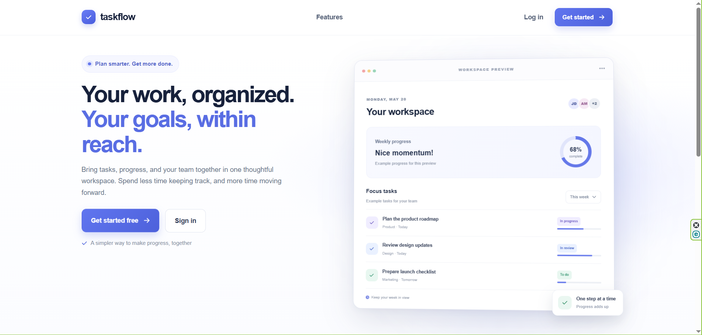
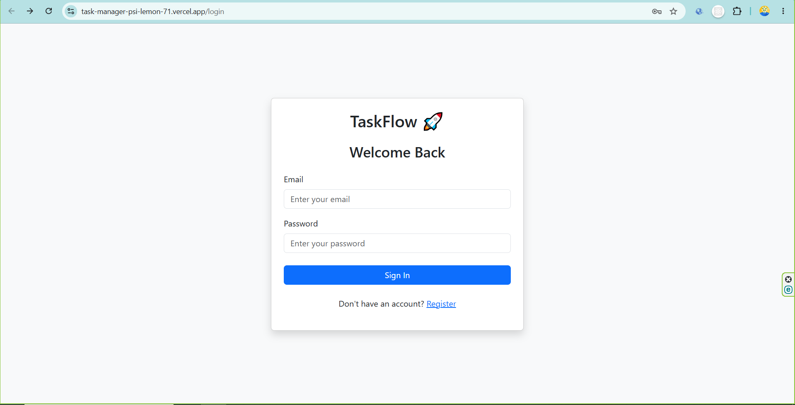
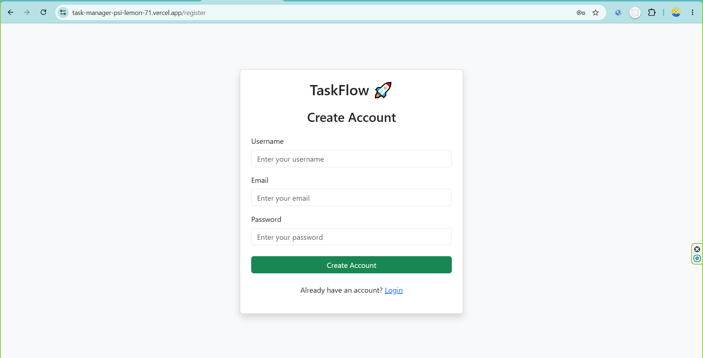
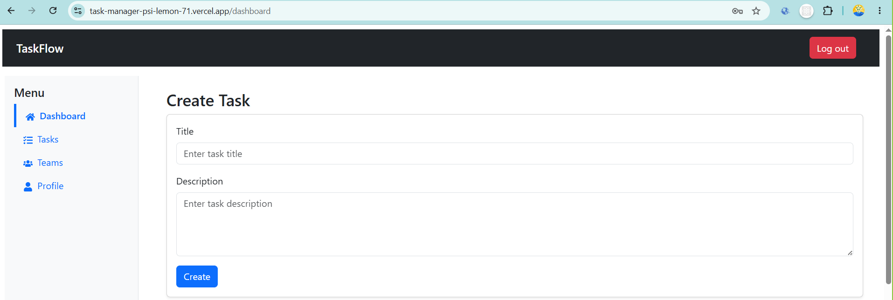
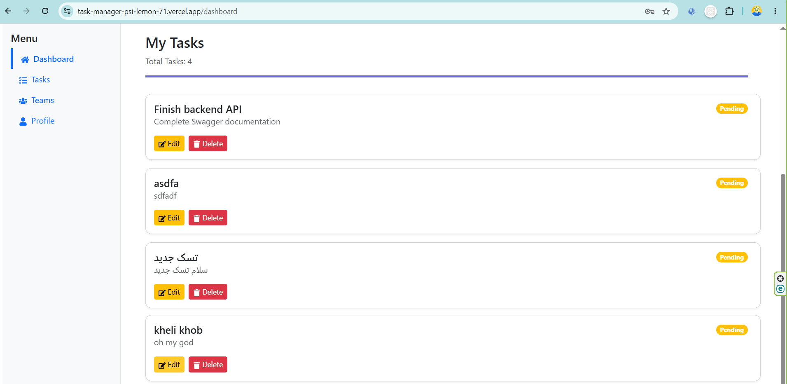
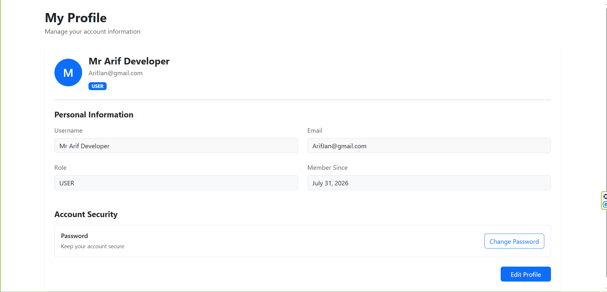
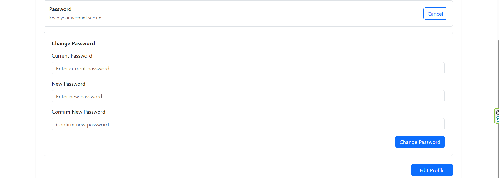
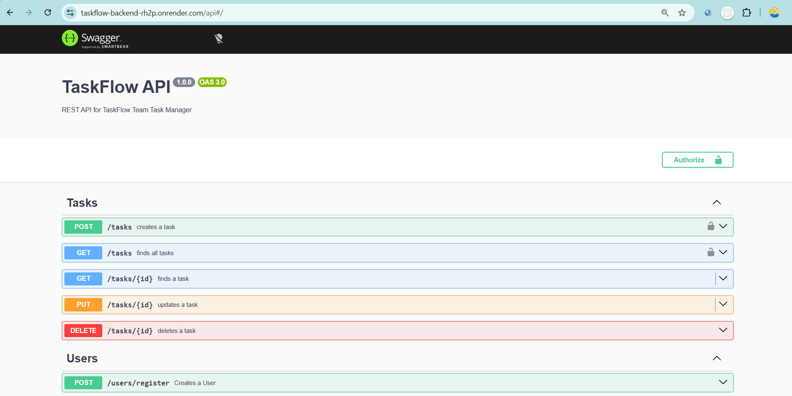

# TaskFlow


TaskFlow is a full-stack task-management portfolio project. Its active frontend is a Next.js App Router application, backed by a NestJS REST API and a PostgreSQL database accessed through Prisma. The repository also retains the previous React + Vite frontend in `frontend-react/` as a reference during the migration.

## Features

- Register and sign in with email and password; authenticated API requests use JWTs.
- Create, view, update, and delete a user's own tasks. The dashboard includes pending/completed filters and pagination.
- View and update profile information, including username and password.
- Enforce user-specific task access in the API, with service tests for task ownership.
- Expose REST endpoints for team creation and management. The active Next.js teams page is currently a placeholder, so the team API is not yet surfaced through the migrated UI.
- Validate API requests and document endpoints with Swagger/OpenAPI.

## Technology stack

### Active frontend

- Next.js 16 App Router, React 19, and TypeScript
- Bootstrap, Tailwind CSS, Axios, React Icons, and SweetAlert2

### Backend

- NestJS 11 and TypeScript
- Prisma ORM 6 with PostgreSQL
- Passport, JWT, and bcrypt for authentication
- Swagger/OpenAPI for API documentation

### Testing and deployment

- Jest and `@nestjs/testing` for backend service tests
- Vercel for the frontend and Render for the backend

`frontend-react/` is the legacy React + Vite application and uses React Router. It is not the active frontend.

## Repository structure

```text
task-manager/
├── frontend/                 # Active Next.js App Router application
│   ├── app/                  # Routes: /, /login, /register, /dashboard, /profile, /tasks, /teams
│   ├── api/                  # Axios API client
│   ├── components/
│   ├── constants/
│   ├── context/
│   ├── services/
│   └── package.json
├── frontend-react/           # Previous React + Vite frontend (legacy)
│   ├── src/
│   ├── public/
│   └── package.json
├── backend/                  # NestJS REST API
│   ├── prisma/
│   │   ├── migrations/
│   │   └── schema.prisma
│   ├── src/
│   │   ├── auth/
│   │   ├── tasks/
│   │   ├── teams/
│   │   ├── users/
│   │   └── prisma/
│   └── package.json
├── screenshots/              # Existing application and Swagger screenshots
├── MIGRATION_PROGRESS.md
└── README.md
```

## Prerequisites

- Node.js 20.9 or later and npm
- PostgreSQL
- Git

## Installation

Clone the repository and install dependencies for the active frontend and backend:

```bash
git clone https://github.com/arifrezaie4-dev/task-manager.git
cd task-manager

cd backend
npm install
cd ../frontend
npm install
```

The legacy frontend has its own `package.json`; install its dependencies from `frontend-react/` only if you intend to work on that app.

## Environment configuration

Create `backend/.env` and set the variables currently read by the application:

```env
DATABASE_URL="postgresql://<USER>:<PASSWORD>@localhost:5432/<DATABASE>?schema=public"
PORT=3000
```

Replace the database placeholders with your local PostgreSQL connection details. Prisma reads `DATABASE_URL` from `backend/prisma/schema.prisma`; the API listens on `PORT`, defaulting to `3000`.

The active frontend currently gets its API base URL from `frontend/constants/api.ts`, which points to the Render deployment. The Axios client uses that constant directly; `NEXT_PUBLIC_API_URL` is not currently supported. To run the frontend against your local API, change the constant to `http://localhost:3000/` in your local working copy. Do not put secrets in `NEXT_PUBLIC_*` variables, since they are exposed to browser code.

The backend currently configures its JWT signing secret and token lifetime in code rather than reading `JWT_SECRET` or `JWT_EXPIRES_IN` from the environment. The existing example environment file should not be taken as evidence that those settings are configurable.

## Local development

1. Start PostgreSQL and create the database named in `DATABASE_URL`.
2. Apply the checked-in Prisma migrations from the backend directory:

   ```bash
   cd backend
   npx prisma migrate dev
   ```

3. In a backend terminal, start the API:

   ```bash
   cd backend
   npm run start:dev
   ```

4. In a separate terminal, start the active Next.js frontend on port `3001`:

   ```bash
   cd frontend
   npm run dev -- --port 3001
   ```

   Open [http://localhost:3001](http://localhost:3001). The API runs at [http://localhost:3000](http://localhost:3000). Configure the frontend API base URL as described above if you want browser requests to use the local API instead of the deployed Render service.

## API and Swagger

Swagger UI is served at `/api`:

- Local: [http://localhost:3000/api](http://localhost:3000/api)
- Render deployment: [https://taskflow-backend-rh2p.onrender.com/api](https://taskflow-backend-rh2p.onrender.com/api)

The API base URL is [https://taskflow-backend-rh2p.onrender.com](https://taskflow-backend-rh2p.onrender.com). Use Swagger UI to inspect the authentication, users, tasks, and teams endpoints.

## Live deployments

The repository previously listed the following deployment URLs. Their availability was checked on October 28, 2026:

- Frontend: [https://task-manager-ten-ecru-81.vercel.app/](https://task-manager-ten-ecru-81.vercel.app/) — the URL returned HTTP 404; the current Vercel URL needs confirmation.
- Backend: [https://taskflow-backend-rh2p.onrender.com](https://taskflow-backend-rh2p.onrender.com) — Render returned HTTP 503 with an application-starting screen during verification.
- Swagger UI: [https://taskflow-backend-rh2p.onrender.com/api](https://taskflow-backend-rh2p.onrender.com/api) — also returned HTTP 503 during verification.

These are not presented as verified working demos. Please confirm the current deployment URLs before sharing them as live demos.

## Screenshots

The following image files are present in `screenshots/`:

| Screen | Image |
| --- | --- |
| Main |  |
| Login |  |
| Registration |  |
| Dashboard |  |
| Tasks |  |
| Profile |  |
| Profile password change |  |
| Swagger UI |  |

These are existing repository screenshots and may show the UI before the Next.js migration.

## Testing and production builds

Run the backend Jest service tests:

```bash
cd backend
npm test -- --runInBand
```

Run a backend production build:

```bash
cd backend
npm run build
```

Build the active frontend for production:

```bash
cd frontend
npm run build
```

The frontend package does not define a test script. Jest is configured in the backend package, and the current service tests cover task ownership behavior.

## Project status and roadmap

The backend includes authentication, task and team API modules, profile endpoints, and Swagger documentation. The active frontend has migrated authentication, dashboard, and profile pages; the `/tasks` route is a basic placeholder and the `/teams` route displays a “coming soon” message. The previous Vite application remains in `frontend-react/`.

This repository demonstrates a full-stack application, but the incomplete frontend migration, unconfirmed deployment URL, and backend configuration that is not environment-driven mean the project should not be described as fully production-ready.

### Next steps

- Complete and validate the Next.js tasks and teams pages.
- Move the frontend API base URL into supported runtime/build configuration.
- Load JWT signing configuration from a secure backend environment variable.
- Reconfirm the deployed frontend and backend URLs.
- Expand automated test coverage beyond task ownership service tests.

## License

No root `LICENSE` file is present, and the backend package declares the project `UNLICENSED`. No open-source license is currently specified.

## Author

**Arif Rezaie** — Junior Full-Stack Developer

- GitHub: [arifrezaie4-dev](https://github.com/arifrezaie4-dev)
